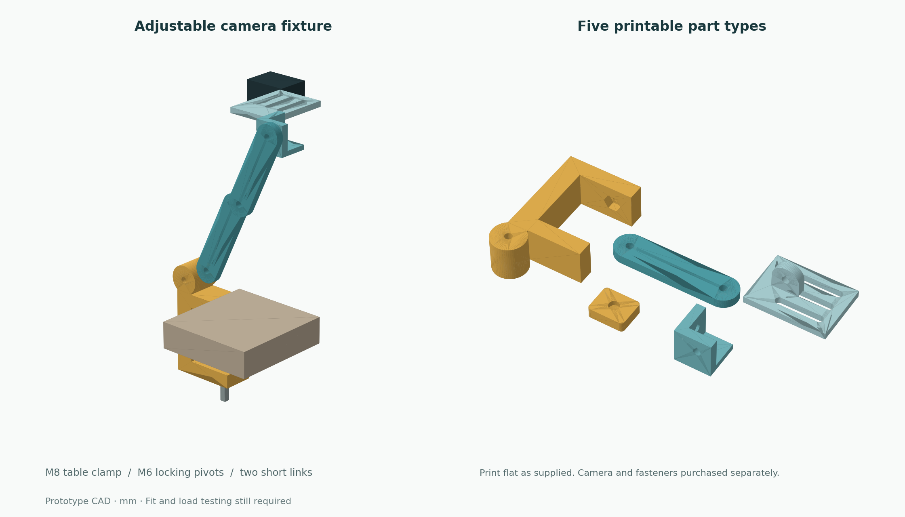

# Printable camera fixture — v0.1

An adjustable **table clamp and short camera boom** for the ingredient-recognition prototype. This is a camera fixture, not a powered arm. It uses purchased M8/M6 fasteners for adjustment and a slotted plate because the camera model has not been chosen yet.



The design is sized around a light USB webcam. Its intended first use is the desk/bench recognition experiment, with the clamp on the table and printed parts outside the pot. It has been exported and checked geometrically; it has **not been printed, fitted, or load-tested**. Choose the camera first, measure its mass and mounting features, then test this fixture with an equivalent dummy mass before mounting that camera.

## Files and print quantities

| File | Quantity | Print-oriented bounding box, mm | Function |
|---|---:|---|---|
| [clamp_body.stl](stl/clamp_body.stl) | 1 | 72 × 114 × 32 | C clamp, captive M8 nut pocket, first M6 pivot |
| [moving_pad.stl](stl/moving_pad.stl) | 1 | 32 × 26 × 9 | Contact pad with a blind socket for the screw tip |
| [link.stl](stl/link.stl) | 1 or 2 | 111 × 26 × 8 | Short arm, 85 mm between M6 pivots |
| [pivot.stl](stl/pivot.stl) | 1 | 32 × 32 × 32 | Right-angle adapter for a second head adjustment axis |
| [camera_head.stl](stl/camera_head.stl) | 1 | 72 × 52 × 30 | Three slotted screw locations and pivot ear |
| [hotpot_camera_mount.scad](hotpot_camera_mount.scad) | source | — | Parametric OpenSCAD model and illustrative assembly |

Start with one link if it gives the needed view. The preview shows two links nearly upright. Two links provide 170 mm total pivot-to-pivot length; they are not meant to become a long horizontal cantilever. The camera plate has three **42 × 6.8 mm capsule slots**, at 15 mm transverse spacing. Those accommodate several screw sizes and adapter positions, but do not guarantee compatibility with an arbitrary webcam clip.

The nominal table-thickness range is approximately **15–45 mm**, with 2 mm contact material on each jaw. A rounded/beveled table edge, thicker pads, or a different screw-tip fit changes the usable range. The clamp throat reaches 48 mm from its back, and the adjustment screw is 30 mm from the back.

## Purchased hardware

For the illustrated two-link build:

| Hardware | Quantity | Location |
|---|---:|---|
| M8 × 80 mm fully threaded clamping screw or bolt | 1 | Table adjustment; a purchased hand grip is convenient |
| Standard M8 hex nut | 1 | Nut pocket **on top of the lower jaw** |
| M6 × 55 mm fully threaded bolt | 1 | Through the 32 mm clamp boss and first 8 mm link |
| M6 × 30 mm fully threaded bolt | 3 | Link-to-link, link-to-adapter, adapter-to-head |
| M6 female star knob or hand-tightening nut | 4 | Joint locking; verify engagement with the actual knob |
| Standard M6 flat washer | 8 | One under each bolt head and one under each knob |
| 2 mm silicone, rubber, or firm protective contact material | 2 pieces | Upper jaw and moving-pad contact face |
| Camera screws/adapter or camera-compatible retaining straps | As required | Determine after choosing the camera |

For one link, omit one M6 × 30 mm bolt, one knob, and two washers. Plain M6 nuts and a wrench also work for initial fit tests. Do not buy a camera screw by guessing its thread: some camera mounts use 1/4-20, while webcam clips may have no screw mount at all.

This is a friction-locking fixture: the knobs clamp broad mating faces together. It has no motor, spring balance, or claimed payload rating. Hardware is likely to cost roughly US$15–35 excluding the camera, filament, and any camera-specific adapter; check local pricing.

## Printing

- Units are **millimetres**. Import at 100% scale.
- Parts are exported in their suggested print orientations, with their lowest surface at Z = 0. Print the clamp on its broad side, links flat, and the adapter on its square base. The camera plate's flat outer face sits on the bed; its ear points up.
- A useful initial PETG setting is a 0.4 mm nozzle, 0.2 mm layers, 5 walls, 6 top/bottom layers, and about 40% infill. These are starting slicer settings, not a tested strength specification.
- The small horizontal holes use teardrop roofs. The clamp nut pocket still has a short bridge; inspect the sliced toolpaths and use local support there if the printer cannot bridge it cleanly. No support should be needed across the open clamp throat in the supplied orientation.
- The defaults are 6.6 mm M6 clearance, 8.8 mm M8 clearance, and 13.5 mm M8 nut flats. Printer tolerances vary. Fit the nut and bolts before printing the full set, and adjust these parameters if necessary.

## Assembly

1. Place contact material on the **underside of the fixed upper jaw**, and on the flat contact face of the moving pad. Keep the pad's blind socket clear.
2. Put the M8 nut in the hex recess on the **top of the lower jaw**. It is intentionally seated on that side so screw reaction presses it into the jaw. Feed the M8 screw from below through the nut.
3. Put the screw tip in the moving pad's blind socket. The pad is loose and can swivel a little; hold it in place while setting the clamp on the table. Turn the screw to seat both contact surfaces.
4. Bolt the first link to the round clamp boss, with a washer under the bolt head and knob. The link sits on the side of the boss. Leave the knob loose enough to set its angle.
5. If using two links, bolt their end holes together face-to-face. Put a washer under the bolt head and knob. Set the links mostly upright for the first test.
6. Bolt the far link to one wall of the right-angle adapter. The adapter's hole axes are perpendicular. Put the camera head's ear against the adapter's other wall and bolt it through that wall's hole. On both adapter joints, put the bolt head inside the adapter and the hand knob outside the link/head ear; keeping both large knobs outside avoids corner interference.
7. Orient the camera plate with its flat mounting surface above its ear. Attach the camera using a suitable screw, a small camera-specific adapter, or retaining straps through the slots. The preview's dark block is only a camera placeholder.
8. Tighten the four joints, route the USB cable with slack at every pivot, and test the view with the actual recognition app. Cable pull can move a light camera even when its own weight does not.

For the first bench fit, use a dummy mass matching the camera, check that the joints hold their angles over 30 minutes, and repeat after changing the pose. Record any angle drift, clamp movement, interference between knobs, and camera-slot mismatch. Those observations determine the next revision.

## Change dimensions and regenerate

Open `hotpot_camera_mount.scad` in OpenSCAD. Select `part="assembly"` to inspect the pose, or one of the five part names to export that printable part. `part="print_layout"` lays out the five types for visual inspection; use the separate STL files for slicing.

Useful top-level parameters are `clamp_width`, `clamp_gap`, `clamp_reach`, `m6_clearance`, `m8_clearance`, `m8_nut_flats`, `link_centres`, and the camera plate dimensions. The illustrative assembly uses the default sizes; update its pose if you change the dimensions. Regenerate the checked print parts with:

```bash
python hardware/export_and_check.py
python hardware/render_preview.py
```

The export script needs OpenSCAD and NumPy. The optional preview script also needs Matplotlib. Or export one part directly from OpenSCAD:

```bash
openscad -o hardware/stl/link.stl -D 'part="link"' hardware/hotpot_camera_mount.scad
```

## What was checked

[geometry_check.json](geometry_check.json) records the current STL checks. All five parts export as a single connected, watertight mesh with consistently oriented edges, positive volume, no degenerate triangles, and a minimum Z of zero. These checks catch broken exports and disconnected pieces; they do not replace printing or physical fit/load tests.
